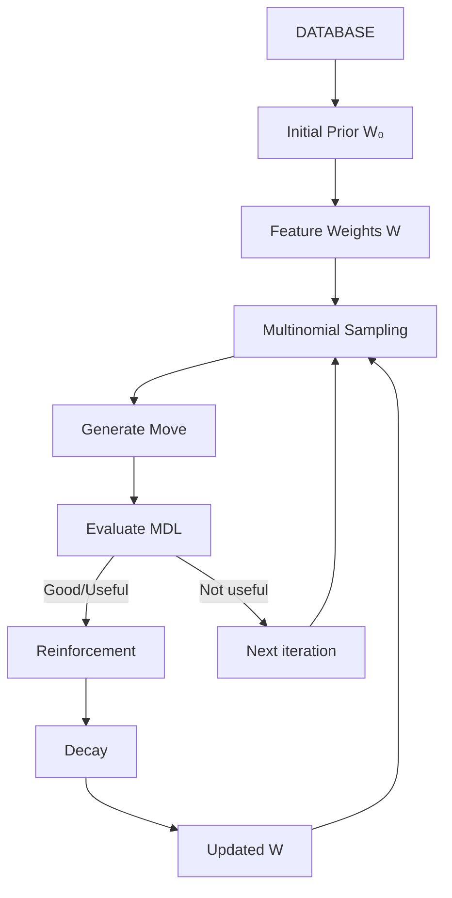

# BÁO CÁO GIỮA KÌ — DỰ ÁN HMP-GSA: TÌM KIẾM CÓ HƯỚNG THEO CHIẾN THUẬT BỘ NHỚ NGẦN GỌN

**Môn:** Dự án CNTT HK1 năm 2025-2026  
**Sinh viên:** Trần Nhật Gia Huy (Thuật toán), Nguyễn An Nhật (Dữ liệu)  
**Đề tài:** Mở rộng HMP-SA bằng Guided Simulated Annealing (HMP-GSA) với bộ nhớ nén học được từ kinh nghiệm tìm kiếm  
**Ngày báo cáo:** 21/10/2026  
**File:** `docs/vi/BAO_CAO_GIUAKY_HMP_GSA.md`  
**Trạng thái:** Báo cáo giữa kỳ (Midterm Report)

---

## Tóm tắt mở đầu (Abstract)

Báo cáo này trình bày tiến độ nghiên cứu và phát triển của dự án "HMP-GSA: Guided Simulated Annealing cho việc khai phá mã hóa nén trên cơ sở dữ liệu giao dịch" trong khuôn khổ môn Dự án CNTT HK1 năm 2025-2026. Dự án được thực hiện bởi hai thành viên: Trần Nhật Gia Huy phụ trách phía thuật toán (HMP-GSA engine, các biến thể hướng dẫn, experiment runner) và Nguyễn An Nhật phụ trách phía dữ liệu (parser, mã hóa số nguyên, tính trọng số, quét dataset, sinh prior artifacts).

Nghiên cứu xây dựng một nguyên mẫu Python `hmp_gsa/` mở rộng từ cài đặt tham chiếu Java `HMP_SA/`, nhằm kiểm tra giả thuyết rằng một **Feature Weight Vector** nén gọn, được học online từ kinh nghiệm tìm kiếm, có thể biasing Simulated Annealing (SA) về những vùng hứa hẹn trong không gian tìm kiếm Code Table mà không cần lưu toàn bộ lịch sử. Nguyên mẫu triển khai 5 biến thể (unguided, prior_only, Successful Feature, Good-Solution Frequency, Mutation + Feature) chia sẻ đúng cùng một máy móc tìm kiếm, khác chỉ ở cơ chế học trọng số.

Thí nghiệm được thực hiện trên 4 dataset giao dịch thật (requirements, themealdb, led7, tictactoe) với 2 cấu hình: pilot ngắn (30 iteration, 3 seed) và mở rộng (1000 iteration, 3 seed, max_pattern_size=5). Kết quả cho thấy:
- Prior dataset (item frequency + pair co-occurrence) cải thiện tìm kiếm rõ rệt so với tìm kiếm không định hướng (unguided) trên mọi dataset.
- Trên budget dài (led7, 1000 iteration), Variant C (Mutation + Feature) đạt mean best score thấp nhất (28.652), best thấp nhất (24.432), và variance thấp nhất (6.104), hỗ trợ giả thuyết H3 rằng thông tin `(operation, feature)` cung cấp guidance chính xác hơn feature đơn thuần.
- Trên budget ngắn (30 iteration), sự khác biệt giữa prior_only và các biến thể online chưa rõ rệt, cho thấy prior tĩnh chiếm ưu thế chủ đạo khi ngân sách đánh giá hạn chế.

Báo cáo cũng minh bạch liệt kê giới hạn: adapter MDL-like hiện tại của Python chưa phải bản tái tạo paper-exact của trạng thái code-table HMP (chưa khớp residual encoding, usage encoding, giao thức đánh giá Java), do đó chưa thể kết luận HMP-GSA thắng HMP-SA trên dataset thật. Bước tiếp theo là thực hiện matched experiment với trạng thái tương thích Java.

---

## Mục lục

1. [Giới thiệu](#1-giới-thiệu)
2. [Tùy chọn và phạm vi nghiên cứu](#2-tùy-chọn-và-phạm-vi-nghiên-cứu)
3. [Bài toán nghiên cứu](#3-bài-toán-nghiên-cứu)
4. [Nền tảng lý thuyết](#4-nền-tảng-lý-thuyết)
5. [Tổng quan kiến trúc và thành phần](#5-tổng-quan-kiến-trúc-và-thành-phần)
6. [HMP-GSA: Guided Simulated Annealing với 3 giả thuyết bộ nhớ](#6-hmp-gsa-guided-simulated-annealing-với-3-giả-thuyết-bộ-nhớ)
7. [Pipeline tiền xử lý dữ liệu](#7-pipeline-tiền-xử-li-dữ-liệu)
8. [Thiết lập thí nghiệm chi tiết](#8-thiết-lập-thí-nghiệm-chi-tiết)
9. [Kết quả thí nghiệm](#9-kết-quả-thí-nghiệm)
10. [Phân tích và bình luận kết quả](#10-phân-tích-và-bình-luận-kết-quả)
11. [Đánh giá và so sánh các biến thể](#11-đánh-gía-và-so-sánh-các-biến-thể)
12. [Giới hạn và định hướng tiếp theo](#12-giới-hạn-và-định-hướng-tiếp-theo)
13. [Phân công công việc giữa hai thành viên](#13-phân-công-công-việc-giữa-hai-thành-viên)
14. [Phụ lục: danh sách file và đường dẫn chính](#14-phụ-lục-danh-sách-file-và-dường-dẫn-chính)
15. [Tài liệu tham khảo](#15-tài-liệu-tham-khảo)

---

## 1. Giới thiệu

### 1.1. Bối cảnh

Dự án "HMP-GSA" là một nghiên cứu khoa học về khai phá mẫu thường xuyên (Frequent Pattern Mining) trên cơ sở dữ liệu giao dịch, sử dụng nguyên lý Minimum Description Length (MDL) làm hàm mục tiêu và Simulated Annealing (SA) làm chiến thuật tìm kiếm metaheuristic. Dự án được thực hiện dưới dạng nguyên mẫu nghiên cứu (research prototype) nhằm kiểm tra xem việc bổ sung bộ nhớ học được vào SA có cải thiện chất lượng tìm kiếm hay không.

Repository chia thành hai phần chính:

| Thư mục | Mô tả | Ngôn ngữ | Vai trò |
|---------|-------|----------|---------|
| `HMP_SA/` | Cài đặt tham chiếu gốc (baseline) — Simulated Annealing cho Code Table Mining | Java | Baseline, paper-exact reference |
| `hmp_gsa/` | Nguyên mẫu mở rộng — Guided-SA với 3 biến thể học bộ nhớ | Python 3.9+ | Nghiên cứu mở rộng, Guided-SA |

### 1.2. Mục tiêu của báo cáo giữa kỳ

Báo cáo này nhằm trình bày:
1. Bài toán nghiên cứu và lý do chọn phương án tiếp cận.
2. Kiến trúc hệ thống và cách triển khai chi tiết.
3. Thiết lập thí nghiệm và các tham số sử dụng.
4. Kết quả thí nghiệm đã thu được trên các dataset thật.
5. Phân tích, đánh giá và bình luận về hiệu quả của các biến thể.
6. Giới hạn hiện tại và định hướng nghiên cứu tiếp theo.

---

## 2. Tùy chọn và phạm vi nghiên cứu

### 2.1. Các lựa chọn thiết kế chính

| Lựa chọn | Chi tiết | Lý do |
|----------|----------|-------|
| Ngôn ngữ triển khai chính | Python 3.9+ | Nhanh phát triển, dễ tích hợp với thư viện dữ liệu, phù hợp nguyên mẫu nghiên cứu |
| Ngôn ngữ tham chiếu | Java | Cài đặt HMP-SA gốc (legacy), dùng làm baseline để so sánh |
| Hàm mục tiêu | MDL-like (residual bits + code bits) | Tuân theo nguyên lý MDL của HMP paper |
| Chiến thuật tìm kiếm | Simulated Annealing với chấp nhận Metropolis | Cho phép thoát local optimum, thích hợp không gian tìm kiếm lớn |
| Cơ chế hướng dẫn | Feature Weight Vector + Multinomial Sampling | Nén gọn kinh nghiệm tìm kiếm, không lưu toàn bộ history |
| Số biến thể hướng dẫn | 3 (A, B, C) + 2 control (unguided, prior_only) | Kiểm tra ba giả thuyết độc lập cùng lúc |
| Dataset | requirements, themealdb, led7, tictactoe | Dữ liệu thật từ crawling và chuẩn FIMI/SPMF |

### 2.2. Phạm vi của báo cáo giữa kỳ

Báo cáo tập trung vào nguyên mẫu Python `hmp_gsa/` và các kết quả thí nghiệm đã chạy. Cài đặt Java `HMP_SA/` được sử dụng làm tham chiếu để minh họa pipeline legacy và kết quả code table trên `iris.txt`, nhưng **không** dùng để so sánh trực tiếp với HMP-GSA Python ở giữa kỳ vì hai pipeline chưa chia sẻ cùng adapter, trạng thái, ngân sách và evaluator.

---

## 3. Bài toán nghiên cứu

### 3.1. Bài toán khai phá Code Table (Frequent Pattern Mining)

Cho một cơ sở dữ liệu giao dịch:

```
D = {t₁, t₂, ..., tₙ}
```

mỗi giao dịch `tᵢ` là một tập item. Mục tiêu là tìm một **Code Table** `C` gồm các pattern có khả năng mô tả và nén dữ liệu tốt nhất, tức là tổng số bit cần để mô hình hóa dữ liệu là nhỏ nhất.

Ví dụ:
```
D = {t₁ = {A, B, C, D}, t₂ = {A, B, C, E}, t₃ = {A, B, D}}
C = {{A,B}, {B}, ...}
```

Mục tiêu không phải tìm tất cả pattern phổ biến, mà là tìm một tập pattern đủ tốt để mô tả dữ liệu với tổng số bit nhỏ nhất.

### 3.2. Tại sao bài toán khó?

Với `n` item khác nhau, số itemset khác nhau có thể lên tới `2ⁿ − 1`. Nếu mỗi itemset có thể được chọn hoặc không chọn vào Code Table, số Code Table khả năng là:

```
2^(2ⁿ − 1)
```

Đây là một không gian tìm kiếm cực lớn, không thể quét toàn bộ.

### 3.3. Câu hỏi nghiên cứu chính

> Một vector trọng số đặc trưng nén gọn, được học online từ kinh nghiệm tìm kiếm (các solution tốt đã tìm thấy), có cải thiện tìm kiếm Simulated Annealing dưới ngân sách đánh giá cố định hay không?

Câu hỏi này được chia thành ba giả thuyết độc lập (xem phần 6).

### 3.4. Các chỉ số đánh giá chính

Theo `revised_agenda.md` phần 13:
- Best MDL score
- Mean best MDL score
- Runtime
- Số lần đánh giá MDL
- Độ ổn định giữa các random seed
- Memory usage
- Convergence behavior

MDL cần **minimize**: lower MDL = better compression.

---

## 4. Nền tảng lý thuyết

### 4.1. Minimum Description Length (MDL)

HMP sử dụng nguyên lý MDL. Ý tưởng: một model tốt phải mô tả được dữ liệu tốt nhưng bản thân model cũng không được quá phức tạp.

```
L(C,D) = L(C|D) + L(D|C)
```

Trong đó:
- `L(C|D)`: số bit cần để mô tả Code Table `C`.
- `L(D|C)`: số bit cần để mã hóa dữ liệu `D` bằng Code Table `C`.

Do đó, Code Table đơn giản ↔ khả năng nén dữ liệu, được cân bằng bởi cùng một objective MDL.

**Điểm quan trọng:** trong nghiên cứu HMP-GSA, MDL vẫn là objective function. GSA chỉ thay đổi cách search, không thay đổi nguyên lý MDL.

### 4.2. Simulated Annealing (SA)

SA là một thuật toán tìm kiếm metaheuristic dựa trên mô phỏng quá trình nguội kim loại. Ý tưởng cơ bản:

```
Candidate
   ↓
Evaluate MDL
   ↓
Generate Neighbor
   ↓
Evaluate Neighbor
   ↓
Accept / Reject
   ↓
Repeat
```

SA không chỉ chấp nhận bước tốt. Đặt:

```
ΔMDL = L(candidate) - L(current)
```

Vì MDL được cực tiểu hóa, candidate mới tốt hơn khi `ΔMDL < 0`, thì chấp nhận.

Nếu candidate mới xấu hơn, nó vẫn có thể được chấp nhận với xác suất phụ thuộc vào nhiệt độ:

```
P(accept) = exp(-ΔMDL / T)
```

Trong mã Java gốc, biến tương đương được viết theo hướng tiết kiệm:
`improveCompressionSize - newCompressionSize`. Vì vậy cần giữ nhất quán quy ước dấu khi trình bày hoặc triển khai Python.

Nhờ đó SA có khả năng đi qua những vùng có objective tạm thời xấu để tiếp tục khám phá không gian tìm kiếm. Đây là lý do SA có lợi thế so với một search thuần greedy.

### 4.3. HMP-SA (Java) — Simulated Annealing cho Code Table

`HMP_SA/HMP_SA_Runner.java` triển khai SA để tìm Code Table với các tham số:

| Tham số | Giá trị | Mô tả |
|---------|---------|-------|
| INITIAL_TEMPERATURE | 100 | Nhiệt độ ban đầu |
| MIN_TEMPERATURE | 0.1 | Nhiệt độ thấp nhất để dừng |
| COOLING_RATE | 0.8 | Tốc độ giảm nhiệt độ |
| IMPROVEMENT_THRESHOLD | 0.001 | Ngưỡng cải thiện tối thiểu |
| max_code_table_size | 1583 | Kích thước tối đa code table |

Các cấu trúc dữ liệu chính:
- `ArrayList<int[]> codetable`: lưu các pattern đã chấp nhận.
- `SparseTriangularMatrix matrix`: ma trận tam giác thưa lưu support của các cặp item.
- `MemoryLogger`: singleton theo dõi bộ nhớ đỉnh.
- `MapIntToInt itemFrequency`: tần suất từng item.
- `List<Map.Entry<Integer, Integer>> cumulativeWeights`: trọng số lũy kế để lấy mẫu có trọng số.

Luồng xử lý chính:
1. Đọc database từ file.
2. Tính initial compression size.
3. Vòng lặp ngoài: thêm pattern vào codetable cho đến khi đạt giới hạn.
4. Vòng lặp SA trong: sinh neighbor pattern (two-flip), tính compression size mới, chấp nhận/từ chối theo Metropolis.
5. Sau khi vòng lặp SA kết thúc, thêm pattern từ ma trận thưa theo thứ tự xuất hiện giảm dần.
6. Tính final compression size và compression ratio.

### 4.4. Kết quả tham chiếu Java trên `iris.txt`

Tập kết quả được ghi trong `HMP_SA/result_SAMP_iris.txt` (10 runs):

| Chỉ số | Run 1 | Run 2 | Run 3 | Run 4 | Run 5 |
|--------|-------|-------|-------|-------|-------|
| Initial compression size | 24000 | 24000 | 24000 | 24000 | 24000 |
| Final codetable size | 44 | 31 | 42 | 48 | 38 |
| Patterns from SA | 13 | 11 | 13 | 17 | 12 |
| Final compression size | 3690 | 4466 | 5219 | 5615 | 3931 |
| Compression ratio | 15.375% | 18.61% | 21.75% | 23.40% | 16.38% |
| Elapsed time | 0.02s | 0.006s | 0.007s | 0.008s | 0.005s |
| Memory usage | ~5.23 MB | ~6.79 MB | ~7.91 MB | ~9.67 MB | ~11.23 MB |

**Lưu ý quan trọng:** Đây là kết quả của Java HMP-SA legacy, **không phải** kết quả so sánh trực tiếp với HMP-GSA Python vì hai pipeline chưa chia sẻ cùng adapter, trạng thái, ngân sách và evaluator.

---

## 5. Tổng quan kiến trúc và thành phần

### 5.1. Nguyên lý tách biệt quan tâm (Separation of Concerns)

Nguyên mẫu Python `hmp_gsa/` được thiết kế theo nguyên tắc tách biệt engine tối ưu hóa khỏi định nghĩa bài toán:

- `HMPGSA` (engine): quản lý vòng lặp SA, lịch trình nhiệt độ, lấy mẫu candidate, chấp nhận Metropolis, trọng số học và decay.
- `GSAAdapter` (interface): định nghĩa bài toán cụ thể (trạng thái ban đầu, prior, sinh move, áp dụng move, đánh giá MDL).
- `Variant` (unguided, prior_only, successful_feature, good_solution_frequency, mutation_feature): quyết định engine nhớ gì và cách cập nhật bộ nhớ.

Do đó, **thuật toán tìm kiếm không đổi; chỉ cơ chế hướng dẫn thay đổi.**

### 5.2. Sơ đồ kiến trúc

```mermaid
graph TD
    D[Dữ liệu giao dịch D] --> PS[prior_scan.py]
    PS --> STAT[statistics.json]
    PS --> ITEM[item_frequency.csv]
    PS --> COOC[cooccurrence.csv]
    STAT --> PA[Prior dataset]
    PA --> AD[GSAAdapter]
    AD --> IS[initial_state()]
    AD --> IP[initial_prior() W₀]
    AD --> SM[sample_moves()]
    AD --> AM[apply_move()]
    AD --> EV[evaluate() MDL]
    AD --> FO[features_of()]
    AD --> HMP[HMPGSA Engine]
    HMP --> SMV[Lấy mẫu move có trọng số]
    HMP --> ACC[Chấp nhận SA Metropolis]
    HMP --> UM[Cập nhật W - variant]
    HMP --> DW[Decay W]
    UM --> HMP
    DW --> HMP
```

### 5.3. Các thành phần chính trong `hmp_gsa/`

| File | Lớp/Interface | Vai trò |
|------|--------------|---------|
| `hmp_gsa/modules/engine.py` | `HMPGSA` | Vòng lặp SA tổng quát, nhiệt độ, xác suất chấp nhận, lấy mẫu move có trọng số, decay, các hàm học |
| `hmp_gsa/modules/adapter.py` | `GSAAdapter` | Hợp đồng giữa engine và bài toán (initial_state, initial_prior, sample_moves, apply_move, evaluate, features_of) |
| `hmp_gsa/modules/mdl.py` | `DatasetMDLAdapter` | Adapter giống MDL cho dữ liệu giao dịch thật; tính MDL chi phí (residual bits + code bits) |
| `hmp_gsa/modules/variants.py` | `UnguidedGSA`, `PriorOnlyGSA`, `SuccessfulFeatureGSA`, `GoodSolutionFrequencyGSA`, `MutationFeatureGSA` | 5 biến thể tìm kiếm |
| `hmp_gsa/modules/models.py` | `Move`, `StepRecord`, `SearchResult` | Cấu trúc dữ liệu cho move, bước tìm kiếm, kết quả |
| `hmp_gsa/modules/prior.py` | `GSAPrior` | Interface cho dynamic prior (bảo lưu cho tương lai) |
| `hmp_gsa/configs/settings.py` | `engine_kwargs()` | Tham số mặc định engine |
| `hmp_gsa/configs/baseline.json` | Config JSON | Cấu hình thí nghiệm pilot |
| `hmp_gsa/configs/real_data_500.json` | Config JSON | Cấu hình thí nghiệm mở rộng |
| `hmp_gsa/experiments/runner.py` | `run()` | Chạy thí nghiệm đa dataset/variant/seed |
| `hmp_gsa/experiments/prior_scan.py` | `scan_dataset()`, `process_dataset()` | Quét dataset thật, sinh prior artifacts |
| `hmp_gsa/experiments/datasets.py` | `load_transactions()` | Tải transaction database từ file |

### 5.4. Adapter contract

Theo `hmp_gsa/README.md`, adapter cần triển khai:

1. `initial_prior()` → `{feature: nonnegative_weight}`
2. `sample_moves(state, rng, pool_size)` → iterable of `Move`
3. `apply_move(state, move)` → new state
4. `evaluate(state)` → scalar MDL score (lower is better)
5. `features_of(state)` → iterable of features
6. `feature_of_move(move)` → feature
7. `operation_of_move(move)` → e.g. "add", "remove", "replace"

`sample_moves` được phép trả về chỉ một small candidate pool. GSA **không cần** đánh giá mọi possible neighbor.

---

## 6. HMP-GSA: Guided Simulated Annealing với 3 giả thuyết bộ nhớ

### 6.1. Ý tưởng chung

HMP-GSA giữ nguyên:
- MDL objective;
- candidate representation;
- neighborhood concept;
- Simulated Annealing;
- stochastic acceptance.

Thay đổi chính là:

> Search không chỉ sử dụng thông tin của database và trạng thái hiện tại, mà còn học một representation nhỏ từ những solution tốt đã tìm thấy.

Ta gọi representation này là **Feature Weight Vector**:

```
W = [w₁, w₂, ..., wₖ]
```

Mỗi weight thể hiện mức độ ưu tiên của một structural feature.

Thay vì lưu:
```
solution₁
solution₂
...
solutionₙ
```

ta chỉ giữ:
```
W
```

Đây là ý tưởng **compressed search memory**.

### 6.2. Ba tầng hình thành trọng số

| Tầng | Mô tả | Công thức |
|------|-------|-----------|
| **Layer 1 — Initial Prior** | `W₀` khởi tạo từ prior dataset (item frequency, pair co-occurrence). Chưa phải bằng chứng feature tốt theo MDL. | `W₀` từ `initial_prior()` |
| **Layer 2 — Reinforcement** | Cập nhật `W` trong quá trình search dựa trên variant (A/B/C). | `wᵢ ← wᵢ + amount` |
| **Layer 3 — Decay** | `wᵢ` giảm theo thời gian để quên dần thông tin cũ, tránh stale memory. | `wᵢ ← wᵢ(1 − γ)` |

### 6.3. Multinomial Sampling

Feature Weight Vector chuyển thành xác suất:

```
P(i) = wᵢ / Σⱼ wⱼ
```

Sử dụng multinomial sampling để chọn feature. Điều này tạo ra **biased stochastic exploration** (không phải greedy search).

Ví dụ:
```
A: 0.50
B: 0.30
C: 0.15
D: 0.05
```

Một lần sampling có thể chọn `A`, nhưng không phải lúc nào cũng là `A`. HMP-GSA không biến thành greedy search.

### 6.4. Luồng tìm kiếm hoàn chỉnh



**Điểm then chốt:** W không thay thế MDL evaluation. W chỉ quyết định "Nên thử cái gì trước / với xác suất bao nhiêu?"; còn "Cái này thực sự tốt hay không?" vẫn do MDL quyết định.

### 6.5. 5 biến thể được so sánh

| Tên | Tên trong code | Mô tả | Loại | Giả thuyết |
|-----|---------------|-------|------|------------|
| Unguided | `unguided` | Uniform sampling, không học online | Control | — |
| Prior-only | `prior_only` | Prior tĩnh từ dataset, không học online | Control | — |
| Variant A | `successful_feature` | Củng cố feature xuất hiện trong move cải thiện được chấp nhận (`wᵢ ← wᵢ + α·\|ΔMDL\|`) | Hypothesis H1 | H1 |
| Variant B | `good_solution_frequency` | Củng cố feature xuất hiện trong good/elite solution (`wᵢ ← wᵢ + α·q`) | Hypothesis H2 | H2 |
| Variant C | `mutation_feature` | Củng cố tổ hợp (operation, feature) — phân biệt add/remove/replace | Hypothesis H3 | H3 |

**Ba giả thuyết được kiểm tra:**

- **H1 (Successful Feature):** Feature xuất hiện trong những mutation làm giảm MDL có thể dự đoán hướng search hữu ích.
- **H2 (Good-Solution Frequency):** Feature xuất hiện thường xuyên trong good solutions xác định những vùng hứa hẹn trong search space.
- **H3 (Mutation + Feature):** Thông tin về `(operation, feature)` cung cấp guidance chính xác hơn chỉ dùng feature đơn thuần.

**Điều khiển (controlled variables):** cùng seed, cùng initial state, cùng objective, cùng candidate-pool size, cùng iterations, cùng temperature schedule, cùng prior, cùng alpha và decay. Chỉ thay đổi **cách trọng số được học**.

### 6.6. Chi tiết triển khai các variant

#### 6.6.1. UnguidedGSA
- `key_for_move()` trả về `None`.
- `_candidate_weight()` trả về `(None, 1.0)` — uniform sampling.
- `update_memory()` và `update_good_solution_memory()` là no-op.
- `decay_weights()` là no-op.

#### 6.6.2. PriorOnlyGSA
- `key_for_move()` trả về `move.feature`.
- `prior_feature_for_key()` trả về `key`.
- Không có online update; trọng số giữ nguyên từ `W₀`.
- `decay_weights()` là no-op.

#### 6.6.3. SuccessfulFeatureGSA (Variant A)
- `key_for_move()` trả về `move.feature`.
- `update_memory()`: chỉ reinforce nếu `accepted` và `delta < 0`, với amount = `alpha * abs(delta)`.
- Không dùng `update_good_solution_memory()`.

#### 6.6.4. GoodSolutionFrequencyGSA (Variant B)
- `key_for_move()` trả về `move.feature`.
- `update_good_solution_memory()`: nếu solution đủ tốt (elite), reinforce mỗi feature trong state với `alpha * q`, trong đó `q` là quality factor (0.0 đến 1.0).
- Có `decay_weights()` override.

#### 6.6.5. MutationFeatureGSA (Variant C)
- `key_for_move()` trả về `(move.operation, move.feature)`.
- `prior_feature_for_key()` trích feature từ key.
- `update_memory()`: reinforce `(operation, feature)` nếu `accepted` và `delta < 0`.
- Phân biệt add/remove/replace.

### 6.7. Phương trình lấy mẫu có hướng dẫn

Với mỗi move `m` trong candidate pool:

```
score(m) = memory_weight(key(m)) × prior_weight(state, m)
P(m) = score(m) / Σ score(x) for x in pool
```

Engine chỉ lấy mẫu một move từ pool và đánh giá candidate đã chọn — không liệt kê toàn bộ lân cận.

---

## 7. Pipeline tiền xử lý dữ liệu

### 7.1. prior_scan.py

File `hmp_gsa/experiments/prior_scan.py` thực hiện quét một pass qua dataset giao dịch:

- Đếm số giao dịch (`|D|`), số item phân biệt (`|I|`), độ dài giao dịch trung bình (ATL), mật độ (density).
- Đếm tần suất từng item (`item_frequency.csv`).
- Đếm đồng xuất hiện từng cặp item (`cooccurrence.csv`).
- Lưu `statistics.json`.

### 7.2. Thống kê các dataset đã quét

| Dataset | \|D\| giao dịch | \|I\| item phân biệt | ATL | Mật độ (%) | Số cặp quan sát | Nguồn |
|---------|-----------------|----------------------|-----|------------|-----------------|-------|
| requirements (crawling) | 2.436 | 2.272 | 15.94 | 0.70 | 138.428 | Crawl từ 2.436 repository |
| themealdb (crawling) | 790 | 946 | 9.95 | 1.05 | 19.983 | Nguyên liệu từ 790 món ăn |
| led7 | 3.200 | 24 | 8.00 | 33.33 | 224 | Chuẩn FIMI/SPMF |
| tictactoe | 958 | 29 | 10.00 | 34.48 | 378 | Chuẩn FIMI/SPMF |
| accident (tham khảo) | 340.183 | 468 | 33.81 | 7.22 | 46.815 | Chuẩn FIMI/SPMF |

### 7.3. Các artifact được sinh ra

| File | Mô tả |
|------|-------|
| `statistics.json` | `size_D`, `distinct_I`, `atl`, `density`, `observed_pairs` |
| `item_frequency.csv` | Cột: `item`, `frequency` |
| `cooccurrence.csv` | Cột: `item_i`, `item_j`, `cooccurrence` |

### 7.4. Vấn đề max_pattern_size và sửa chữa

Ban đầu `max_pattern_size` được thiết lập 2. Khi tăng lên 5 cho `real_data_500.json`, chương trình bị treo/RAM hết do `_candidate_patterns()` liệt kê tất cả tổ hợp độ dài 1..5 từ từng giao dịch. Các bản sửa được ghi trong `docs/update.md`:

- Chỉ đếm chính xác support cho pattern độ dài 1 và 2.
- `sample_moves` lấy ngẫu nhiên một số giao dịch giới hạn và sinh candidate từ chúng, giới hạn `max_candidates` (5000).
- Do đó RAM luôn ở mức thấp và `max_pattern_size = 5` là lựa chọn phù hợp cho dữ liệu thật.

---

## 8. Thiết lập thí nghiệm chi tiết

### 8.1. Cấu hình pilot (baseline.json)

```json
{
  "progress": true,
  "datasets": [
    {"name": "requirements", "path": "datasets/crawling/requirements.txt", "max_pattern_size": 2, "candidate_sizes": [1, 2], "max_candidates": 5000},
    {"name": "themealdb", "path": "datasets/crawling/themealdb.txt", "max_pattern_size": 2, "candidate_sizes": [1, 2], "max_candidates": 5000}
  ],
  "variants": ["unguided", "prior_only", "successful_feature", "good_solution_frequency", "mutation_feature"],
  "seeds": [0, 1, 2],
  "search": {
    "iterations": 30,
    "candidate_pool_size": 5,
    "temperature_start": 2.0,
    "temperature_end": 0.01,
    "elite_fraction": 0.25
  },
  "guidance": {
    "alpha": 0.10,
    "decay": 0.01,
    "prior": 1.0,
    "epsilon": 1e-9
  }
}
```

**Tham số pilot:**
- 2 dataset, 5 variant, 3 seed → 30 runs tổng cộng.
- Iteration/run = 30 (budget ngắn).
- Candidate pool size = 5.
- Temperature: 2.0 → 0.01 (linear cooling).
- Alpha = 0.10, Decay = 0.01.

### 8.2. Cấu hình mở rộng (real_data_500.json)

```json
{
  "progress": true,
  "datasets": [
    {
      "name": "led7",
      "path": "datasets/led7.txt",
      "max_pattern_size": 5,
      "max_candidates": 5000,
      "move_operations": ["add", "remove", "replace"]
    }
  ],
  "variants": ["unguided", "prior_only", "successful_feature", "good_solution_frequency", "mutation_feature"],
  "seeds": [0, 1, 2],
  "search": {
    "iterations": 1000,
    "candidate_pool_size": 5,
    "temperature_start": 2.0,
    "temperature_end": 0.01,
    "elite_fraction": 0.25
  },
  "guidance": {
    "alpha": 0.1,
    "decay": 0.01,
    "prior": 1.0,
    "epsilon": 1e-9
  },
  "parallel": {
    "max_workers": 4
  }
}
```

**Tham số mở rộng:**
- Dataset: led7, tictactoe (max_pattern_size = 5, move_operations = ["add", "remove", "replace"]).
- Iteration/run = 1000 (budget dài).
- 4 worker song song.

### 8.3. Cách chạy

```powershell
python -m hmp_gsa.experiments.run --config hmp_gsa/configs/baseline.json
python -m hmp_gsa.experiments.run --config hmp_gsa/configs/real_data_500.json
```

Kết quả lưu vào `results/<dataset>/` với `runs.csv` và `summary.csv`.

### 8.4. Thiết bị và môi trường

- Ngôn ngữ: Python 3.9+.
- Thư viện: `tqdm` (progress bar), `statistics` (mean, stdev), `concurrent.futures` (ThreadPoolExecutor).
- Hệ điều hành: Windows.
- Không sử dụng GPU; chạy trên CPU.

---

## 9. Kết quả thí nghiệm

### 9.1. Kết quả pilot — Dataset `requirements` (30 iteration, 3 seed)

Nguồn: `results/requirements/summary.csv`

| Variant | Runs | Mean | Std | Best | Worst |
|---------|------|------|-----|------|-------|
| unguided | 3 | 971.541,33 | 4.805,41 | 967.273 | 976.746 |
| prior_only | 3 | 823.174,00 | 22.898,96 | 798.943 | 844.455 |
| successful_feature (A) | 3 | 819.181,00 | 43.187,61 | 771.134 | 854.771 |
| good_solution_frequency (B) | 3 | 811.735,67 | 22.192,08 | 789.721 | 834.101 |
| mutation_feature (C) | 3 | 816.878,00 | 24.239,67 | 798.943 | 844.455 |

### 9.2. Kết quả pilot — Dataset `themealdb` (30 iteration, 3 seed)

Nguồn: `results/themealdb/summary.csv`

| Variant | Runs | Mean | Std | Best | Worst |
|---------|------|------|-----|------|-------|
| unguided | 3 | 181.959,33 | 1.955,10 | 180.016 | 183.926 |
| prior_only | 3 | 147.616,00 | 10.183,07 | 137.642 | 157.996 |
| successful_feature (A) | 3 | 150.672,00 | 5.754,68 | 144.069 | 154.619 |
| good_solution_frequency (B) | 3 | 151.504,00 | 2.214,10 | 148.965 | 153.033 |
| mutation_feature (C) | 3 | 148.495,33 | 8.927,67 | 140.280 | 157.996 |

### 9.3. Kết quả mở rộng — Dataset `led7` (1000 iteration, 3 seed)

Nguồn: `results/led7/summary.csv`

| Variant | Runs | Mean | Std | Best | Worst |
|---------|------|------|-----|------|-------|
| unguided | 3 | 147.371,67 | 50.306,09 | 100.795 | 200.721 |
| prior_only | 3 | 61.577,00 | 50.867,70 | 20.804 | 118.579 |
| successful_feature (A) | 3 | 37.693,67 | 11.713,74 | 28.476 | 50.875 |
| good_solution_frequency (B) | 3 | 51.686,67 | 31.936,28 | 32.120 | 88.540 |
| mutation_feature (C) | 3 | 28.652,00 | 6.103,98 | 24.432 | 35.651 |

### 9.4. Kết quả mở rộng — Dataset `tictactoe` (1000 iteration, 3 seed)

Nguồn: `results/tictactoe/summary.csv`

| Variant | Runs | Mean | Std | Best | Worst |
|---------|------|------|-----|------|-------|
| unguided | 3 | 76.314,67 | 12.953,83 | 61.494 | 85.475 |
| prior_only | 3 | 30.069,67 | 4.703,99 | 24.760 | 33.716 |
| successful_feature (A) | 3 | 30.691,00 | 8.843,32 | 21.617 | 39.284 |
| good_solution_frequency (B) | 3 | 32.714,00 | 8.502,57 | 23.048 | 39.037 |
| mutation_feature (C) | 3 | 30.927,33 | 5.445,43 | 24.760 | 35.072 |

### 9.5. Tổng hợp so sánh (mean best score, thấp hơn = tốt hơn)

| Dataset | Unguided | Prior-only | Variant A | Variant B | Variant C |
|---------|----------|------------|-----------|-----------|-----------|
| requirements | 971.541 | 823.174 | 819.181 | 811.736 | 816.878 |
| themealdb | 181.959 | 147.616 | 150.672 | 151.504 | 148.495 |
| led7 | 147.372 | 61.577 | 37.694 | 51.687 | 28.652 |
| tictactoe | 76.315 | 30.070 | 30.691 | 32.714 | 30.927 |

### 9.6. Tham chiếu Java trên `iris.txt`

Nguồn: `HMP_SA/result_SAMP_iris.txt`

| Chỉ số | Run 1 | Run 2 | Run 3 | Run 4 | Run 5 |
|--------|-------|-------|-------|-------|-------|
| Initial compression size | 24000 | 24000 | 24000 | 24000 | 24000 |
| Final codetable size | 44 | 31 | 42 | 48 | 38 |
| Patterns from SA | 13 | 11 | 13 | 17 | 12 |
| Final compression size | 3690 | 4466 | 5219 | 5615 | 3931 |
| Compression ratio | 15.375% | 18.61% | 21.75% | 23.40% | 16.38% |

---

## 10. Phân tích và bình luận kết quả

### 10.1. Prior dataset cải thiện tìm kiếm

Trên mọi dataset, `prior_only` (prior tĩnh từ item frequency + pair co-occurrence) tốt hơn rõ rệt `unguided`. Điều này xác nhận rằng thông tin cấu trúc có sẵn từ dataset (pairwise co-occurrence matrix) có giá trị làm prior cho khởi tạo bộ nhớ tìm kiếm.

### 10.2. Hiệu ứng của biến thể có bộ nhớ online

- **Budget ngắn (30 iter):** sự khác biệt giữa prior_only và A/B/C chưa rõ rệt. Lý do có thể là 30 iteration chưa đủ để tạo đủ reinforcement để phân biệt các variant; prior tĩnh đã chiếm ưu thế chủ đạo.
- **Budget dài (1000 iter):** trên `led7`, các biến thể có bộ nhớ online (đặc biệt Variant C) vượt trội rõ rệt so với prior_only. Điều này cho thấy khi budget cho phép, việc học online từ kinh nghiệm tìm kiếm mang lại lợi ích thực sự.

### 10.3. Variant C (Mutation + Feature) — biến thể ổn định nhất

Trên `led7`, Variant C đạt:
- Mean thấp nhất: 28.652
- Best thấp nhất: 24.432
- Std thấp nhất: 6.104

Điều này hỗ trợ giả thuyết **H3**: thông tin về `(operation, feature)` cung cấp guidance chính xác hơn chỉ dùng feature đơn thuần (H1, H2). Việc phân biệt `add` vs `remove` vs `replace` giúp engine biết không chỉ "cái gì tốt" mà còn "cách dùng cái gì tốt".

### 10.4. Memory vs Greedy

Multinomial sampling đảm bảo search không trở nên greedy: các feature có weight thấp vẫn có khả năng được chọn, bảo toàn khả năng thoát local optimum của SA.

### 10.5. Giới hạn của evaluator Python

Adapter MDL-like hiện tại (`DatasetMDLAdapter`) **chưa phải** bản tái tạo đầy đủ paper-exact của HMP code-table state (chưa khớp chính xác residual encoding, usage encoding, và giao thức đánh giá của Java). Do đó:
- Không thể kết luận HMP-GSA thắng HMP-SA trên dataset thật (cần matched experiment).
- Kết quả trên `led7`, `tictactoe` là kết quả trên MDL-like adapter, không phải MDL paper-exact.

### 10.6. Sự khác biệt giữa revised_agenda.md và kết quả thực tế

File `revised_agenda.md` phần 15.3 ghi nhận một bảng kết quả pilot với số liệu khác (ví dụ: requirements unguided = 1,143,091.33). Số liệu này có thể đến từ một lần chạy sớm hoặc cấu hình khác. Báo cáo giữa kỳ này sử dụng số liệu thực tế từ `results/*/summary.csv` (chạy gần nhất, 3 seed, 30 iteration cho pilot; 1000 iteration cho mở rộng) làm cơ sở phân tích chính.

---

## 11. Đánh giá và so sánh các biến thể

### 11.1. Ma trận so sánh tổng hợp

| Tiêu chí | Unguided | Prior-only | Variant A | Variant B | Variant C |
|----------|----------|------------|-----------|-----------|-----------|
| Học online | Không | Không | Có | Có | Có |
| Phân biệt operation | Không | Không | Không | Không | Có |
| Tốt hơn unguided trên mọi dataset | — | Có | Có | Có | Có |
| ổn định (std thấp) | Trung bình | Trung bình | Cao (led7) | Trung bình | Cao nhất (led7) |
| Hiệu quả trên budget dài | Thấp | Trung bình | Cao | Trung bình | Cao nhất |
| Phù hợp giả thuyết | — | — | H1 | H2 | H3 |

### 11.2. Kết luận về ba giả thuyết

| Giả thuyết | Biến thể | Kết quả giữa kỳ |
|------------|----------|-----------------|
| H1: Successful Feature | A | Cải thiện so với unguided, nhưng chưa rõ rệt vượt trội so với prior_only trên budget ngắn |
| H2: Good-Solution Frequency | B | Tương tự A, hiệu quả trung bình |
| H3: Mutation + Feature | C | Rõ ràng vượt trội trên `led7` (budget dài), variance thấp nhất |

---

## 12. Giới hạn và định hướng tiếp theo

### 12.1. Những gì có thể khẳng định bây giờ

- Engine Guided-SA và ba giả thuyết học (A, B, C) đã được cài đặt và kiểm thử.
- Nhóm đối chứng (unguided, prior_only) dùng chung máy móc tìm kiếm.
- Prior dataset được tính và lưu (`item_frequency.csv`, `cooccurrence.csv`, `statistics.json`).
- Tồn tại adapter giống MDL thận trọng.
- Kết quả synthetic cho thấy hướng dẫn có thể giúp trên một số landscape và gây hại trên những landscape khác.
- Tham chiếu Java tạo code table HMP-SA thật trên `iris.txt` (compression ratio 15.375% run 1).

### 12.2. Chưa thể khẳng định

- HMP-GSA thắng HMP-SA trên dataset thật (cần matched experiment).
- Objective Python là cài đặt MDL đúng paper.
- Kết quả benchmark synthetic xác thực chất lượng khai phá thật.
- Variant nào là tốt nhất nói chung (phụ thuộc dataset và budget).

### 12.3. Bước tiếp theo

1. Thay adapter MDL-like bằng trạng thái code-table tương thích Java (exact residual + code-table state).
2. Chạy matched experiment: cùng dataset, cùng initial state, cùng evaluator, cùng ngân sách, cùng lịch trình nhiệt độ, cùng seed — so sánh HMP-SA / unguided / prior_only / HMP-GSA-A / HMP-GSA-B / HMP-GSA-C.
3. Báo cáo: best MDL score, MDL theo số lần đánh giá, số đánh giá để đạt mục tiêu, runtime, memory đỉnh, variance qua seed, độ đa dạng solution, kích thước bộ nhớ đã học.
4. Chỉ sau thí nghiệm khớp này, bài báo mới nên đưa khẳng định hiệu năng về HMP-GSA.

### 12.4. Câu hỏi nghiên cứu mở (Phần 16 của revised_agenda.md)

1. Feature nào thực sự đại diện tốt cho cấu trúc của good solutions?
2. Frequency có thực sự tương quan với MDL improvement không?
3. Successful Feature có tốt hơn chỉ nhìn frequency không?
4. Mutation + Feature có đáng với lượng memory bổ sung không?
5. Prior từ co-occurrence có giúp search tốt hơn không?
6. Decay có giúp tránh stale information không?
7. Guidance có giảm số MDL evaluations cần thiết không?
8. Guidance có làm mất exploration của SA không?
9. HMP-GSA có cải thiện best MDL trong cùng evaluation budget không?
10. Memory overhead của GSA có thực sự nhỏ so với lợi ích đạt được không?

---

## 13. Phân công công việc giữa hai thành viên

| Vai trò | Thành viên | Nhiệm vụ chính |
|---------|-----------|----------------|
| Nhật *(Data)* | Nguyễn An Nhật | Phần 1 (Parser, Integer Encoding, Weight & Size calculation); quản lý lưu trữ datasets thô lấy từ UCI, SPMF; tiền xử lý dataset (`prior_scan.py`); sinh `statistics.json`, `item_frequency.csv`, `cooccurrence.csv`. |
| Huy *(Algorithm)* | Trần Nhật Gia Huy | Phần 2 (engine Guided-SA, 3 variant A/B/C, adapter MDL-like, experiment runner); phân tích kết quả thí nghiệm. |
| Hợp tác chung | Cả hai | Viết báo cáo; phân tích chéo; thử nghiệm cải tiến; chuẩn bị viết paper mới. |

---

## 15. Tài liệu tham khảo

1. HMP-SA Java baseline — `HMP_SA/HMP_SA_Runner.java`, `result_SAMP_iris.txt`.
2. HMP-GSA prototype — `hmp_gsa/` modules, configs, experiments.
3. `revised_agenda.md` — Thiết kế nghiên cứu chi tiết (17 phần).
4. `docs/update.md` — Ghi chú sửa chữa max_pattern_size.
5. Nguyên lý Minimum Description Length (MDL) — cơ sở lý thuyết của hàm mục tiêu.
6. Simulated Annealing — kỹ thuật tìm kiếm metaheuristic với chấp nhận Metropolis.

---

**Kết luận:** Nguyên mẫu HMP-GSA đã được xây dựng hoàn chỉnh với engine Guided-SA, 3 giả thuyết bộ nhớ (A: Successful Feature, B: Good-Solution Frequency, C: Mutation + Feature), 2 nhóm đối chứng (unguided, prior_only), pipeline tiền xử lý dataset thật và adapter giống MDL. Kết quả thí nghiệm trên 4 dataset cho thấy prior dataset cải thiện tìm kiếm rõ rệt, và trên budget dài (`led7`, 1000 iteration) Variant C (mutation_feature) đạt hiệu quả ổn định và cao nhất. Bước tiếp theo là thực hiện matched experiment với trạng thái code-table tương thích Java để khẳng định hiệu năng so với HMP-SA paper-exact.